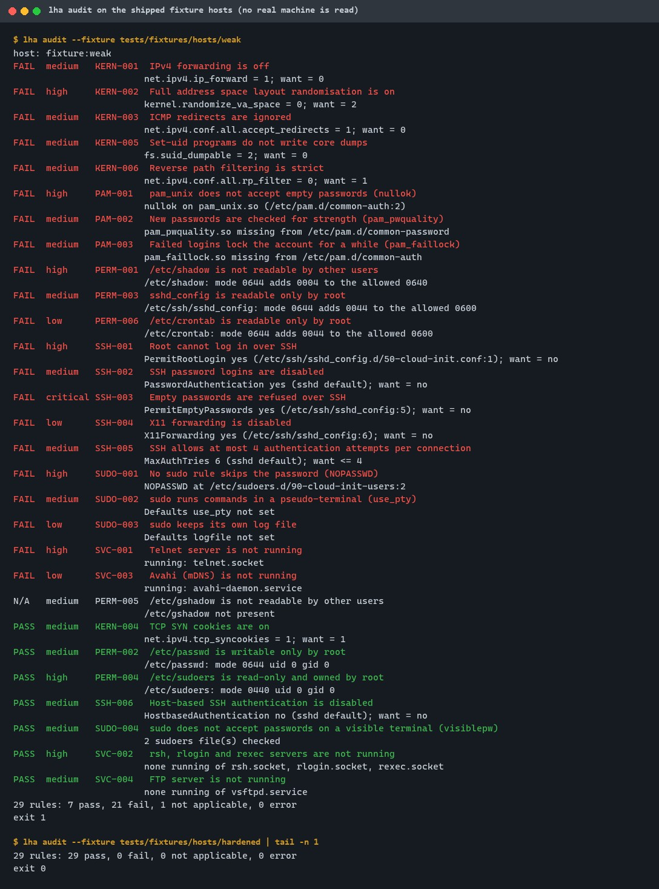
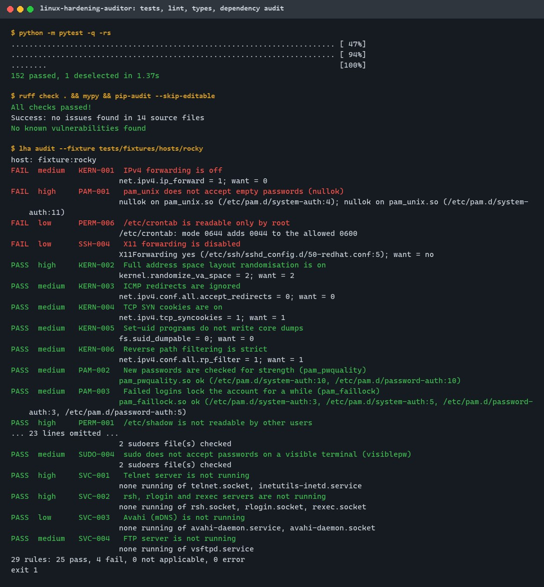
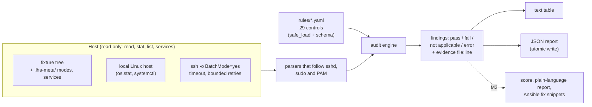
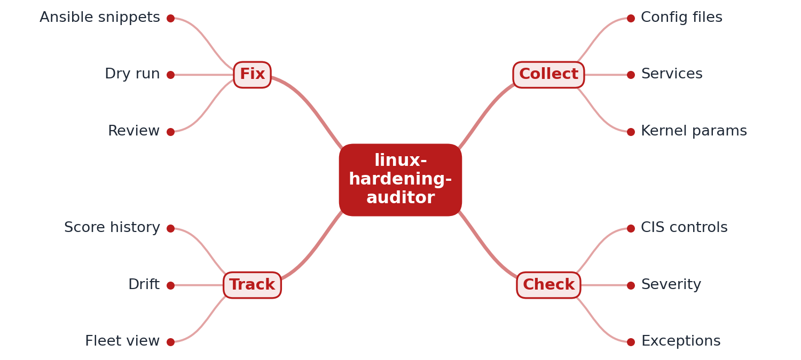

# linux-hardening-auditor

[](https://github.com/EquinoxWN/linux-hardening-auditor/actions/workflows/ci.yml)


> Most servers run with insecure defaults nobody checked: audit Linux hosts against CIS-style controls and generate safe, reviewable fixes.

Part of my **Cyber Security** list · Python · Linux · core project

## Proof it works

`lha audit` on the `weak` fixture host (a Debian cloud image with typical leftovers) finds all 21
planted weaknesses, cites the file and line behind each verdict, and the `hardened` fixture
passes all 29 rules. Only fixture trees shipped in this repository were audited; the author's
machine was never read:



152 tests pass locally (parsers, the six check kinds, the host back ends including SSH with a fake
runner, rule validation, end to end on three fixture hosts); lint, strict types and the dependency
audit are clean. The Rocky fixture shows the traps the parsers handle: a `Match` block that is not
global and sudo include files that sudo itself would skip:



## Architecture

**What M1 runs today:**



**Full roadmap (M1 to M3):**



## How it works

_Steps 1 and 2 are built and tested (M1); the rest is on the [roadmap](#roadmap)._

1. The auditor reads configuration (SSH, sudo, PAM, sysctl, file permissions, running services) locally or over SSH.
2. Each control is a YAML rule with a check, severity, rationale and fix.
3. Hosts get a score and a report explaining each failed control in plain language.
4. Fixes are generated as Ansible snippets to review and apply, never changed silently.
5. Exceptions are recorded with a reason and an expiry date.
6. Vagrant lab VMs (Ubuntu and Rocky) are audited before and after hardening and compared with Lynis.

What M1 reads, and how:

| Area | Source | Read the way the daemon reads it |
|---|---|---|
| SSH | `/etc/ssh/sshd_config` and its `Include` files | first value wins, `Include` read in place in lexical order, options after `Match` are not global, sshd's default when unset |
| sudo | `/etc/sudoers`, `#include`/`@include`, `#includedir`/`@includedir` | include-dir files whose name has a `.` or ends in `~` are skipped; last `Defaults` wins; `!` negates |
| PAM | `common-*` (Debian, Ubuntu) or `system-auth`/`password-auth` (Rocky, RHEL) | bracketed controls, `-type` lines, module basename and arguments |
| Kernel | `/proc/sys/...` | the running value |
| Permissions | mode, uid, gid of six sensitive files | any bit beyond the allowed mode fails, including setuid |
| Services | `systemctl list-units --type=service,socket --state=running,listening` | unit names |

Each finding is `pass`, `fail`, `not_applicable` (the subject is absent, e.g. no sshd) or `error`
(it could not be read, e.g. no permission). Exit code: 0 clear, 1 a control failed, 2 bad input
or rules, 3 something could not be read.

## Who it helps

- **Who:** Linux administrators and platform or security engineers responsible for a few to a few hundred servers.
- **The problem:** Insecure settings hide in places a quick look misses, such as a cloud-init drop-in that re-enables root login before the main sshd_config is read, or a `NOPASSWD` sudo rule in an include directory.
- **How to use it:** Run `lha audit --ssh admin@host` (or `--local` on the host) to get each control's verdict with the file and line behind it, and a JSON report for tracking. Add or change controls by editing YAML rules, which are validated before any host is read.

## Tech stack

| Area | In M1 | Planned |
|---|---|---|
| Core | Python 3.11+, PyYAML (`safe_load`), read-only `Host` interface: fixture tree, local Linux host, system `ssh` client | Optional `sshd -T` source for exact effective sshd values |
| Rules | 29 CIS-style YAML controls in six declarative check kinds (SSH, sudo, PAM, kernel, permissions, services) | Exceptions with reason and expiry (M3) |
| Output | Text table, JSON report written atomically, exit codes | Score, plain-language report, Ansible remediation snippets (M2) |
| Lab | Three fixture hosts (hardened, weak, Rocky layout); CI audit of the Ubuntu runner (not yet run) | Vagrant Ubuntu and Rocky VMs, comparison with Lynis (M3) |

Language: **Python** (3.11+). Code in [`src/linux_hardening_auditor/`](src/linux_hardening_auditor): host back ends (`hosts.py`), daemon-aware parsers (`parsers.py`), check kinds (`checks.py`), rule loading (`rules.py`), the audit engine and reports (`audit.py`) and the CLI (`cli.py`); the rules are in [`rules/`](src/linux_hardening_auditor/rules).

## Run it

**Prerequisites:** Python 3.11+. For `--ssh`: the OpenSSH client and key-based access to the
host (batch mode never prompts for a password). `--local` runs on Linux only; run it as root so
`/etc/sudoers` can be read. No environment variables are read; everything is a flag.

```bash
python -m venv .venv && source .venv/bin/activate   # Windows: .venv\Scripts\activate
make setup     # install the package and dev tools
make lint      # ruff, ruff format, mypy --strict
make test      # 152 tests (the live test is CI-only)
make demo      # audit the three fixture hosts
make audit     # pip-audit
```

Audit a host:

```bash
lha audit --fixture tests/fixtures/hosts/weak          # a fixture tree (what this repo tests)
sudo lha audit --local --json report.json              # the Linux host you are on
lha audit --ssh admin@web1 --port 22 --timeout 15 --retries 2 --only SSH-001,SUDO-001
lha rules list                                         # the 29 bundled controls
lha rules validate --rules my-rules/                   # check your own rule directory
```

A fixture tree is a directory standing in for `/`, plus `.lha-meta/stat.tsv` (mode, uid, gid and
path per line, as from `stat -c '%a\t%u\t%g\t%n'`) and `.lha-meta/services.txt` (output of the
`systemctl list-units` command above), because a Windows or macOS checkout cannot hold Linux
modes or a running systemd.

A rule:

```yaml
rules:
  - id: SSH-001
    title: Root cannot log in over SSH
    severity: high            # low | medium | high | critical
    rationale: A direct root login gives an attacker who steals one credential full control.
    fix: Set "PermitRootLogin no" before any drop-in that sets it, then reload sshd.
    check:
      kind: sshd_option       # sshd_option | sysctl | file_mode | pam_module | sudoers | services_not_running
      option: PermitRootLogin
      expect: {equals: "no"}  # equals | one_of | max | min
      default: prohibit-password
```

## Tests and results

Full numbers and commands: [docs/results/m1.md](docs/results/m1.md). The 10-rule quality check (failure paths, retry safety, mutation testing) is in [docs/quality/2026-11-01.md](docs/quality/2026-11-01.md).

| Check | Result |
|---|---|
| Tests (`make test`) | **152 passed** locally, 0 failed; 1 live test runs in CI only (not run yet) |
| `hardened` fixture | 29 pass, 0 fail, exit 0 |
| `weak` fixture | exactly the 21 planted weaknesses fail, 7 pass, 1 not applicable (no gshadow), exit 1 |
| `rocky` fixture | exactly 4 fail (X11 drop-in, `nullok`, `ip_forward=1`, crontab 0644); the `Match` block and the skipped sudo include files do not cause false failures |
| Mutation testing | 12 of 12 hand mutants killed |
| Lint / audit | ruff, mypy `--strict` clean; `pip-audit`: no known vulnerabilities |

| Test file | Tests | What it proves |
|---|---|---|
| `test_parsers.py` | 22 | sshd first-value-wins, in-place `Include`, `Match` not global, loops refused, randomised check against a naive model; PAM line parsing; sudo include/includedir rules and Defaults |
| `test_checks.py` | 56 | the four comparisons; each of the six check kinds passes, fails and is not applicable on the right input; 16 malformed specs rejected |
| `test_hosts.py` | 39 | path validation; fixture tree reads, manifest and size limits, refusal of links that leave the tree; SSH target validation, quoting, timeouts, bounded retries with backoff, error handling |
| `test_rules.py` | 18 | the 29 bundled rules load; malformed rule files, unsafe YAML tags, duplicates and oversized files rejected |
| `test_audit.py` | 17 | exact verdicts on three fixture hosts, error findings, exit codes, atomic JSON report, CLI |
| `test_live.py` | 0 (+1 in CI) | the Ubuntu runner is audited as root with no collection errors |

## Roadmap

**M1** (≈15 h)
- [x] Write `docs/rfc/0001-design.md`: problem, goals, non-goals, chosen design
- [x] The auditor reads configuration (SSH, sudo, PAM, sysctl, file permissions, running services) locally or over SSH.
- [x] Each control is a YAML rule with a check, severity, rationale and fix.

**M2** (≈20 h)
- [ ] Hosts get a score and a report explaining each failed control in plain language.
- [ ] Fixes are generated as Ansible snippets to review and apply, never changed silently.

**M3** (≈25 h)
- [ ] Exceptions are recorded with a reason and an expiry date.
- [ ] Vagrant lab VMs (Ubuntu and Rocky) are audited before and after hardening and compared with Lynis.
- [ ] Publish the proof below with real numbers

## Proof

What this repo must show before it counts as done:

- Before/after scores on lab VMs, and agreement with Lynis on overlapping checks.

| Result | Value |
|---|---|
| M3 proof above | Not measured yet (M3). Current M1 numbers: see [Tests and results](#tests-and-results). |

## Why it matters

- **Interview angle:** 'Harden a fleet of Linux servers' and security-baseline questions.
- **Upstream I'd like to contribute to:** Lynis or OpenSCAP: tests or rule docs.

## Design docs

- [RFC 0001: design](docs/rfc/0001-design.md)
- [ADR 0001: record architecture decisions](docs/adr/0001-record-architecture-decisions.md)
- [ADR 0002: read-only host interface and the system ssh client](docs/adr/0002-system-ssh-client-and-read-only-host.md)
- [ADR 0003: declarative check kinds, never code](docs/adr/0003-declarative-check-kinds.md)
- [M1 results](docs/results/m1.md)
- [Quality check (10 rules)](docs/quality/2026-11-01.md)

## Scope

This is a learning and portfolio system, not a hosted production service. The auditor only reads:
it never changes the host it audits, and fixes are text for a person to review. The rules are
CIS-style controls written for this project, not certified CIS benchmark content. Known limits:
sshd `Match` blocks are not evaluated, paths with spaces are rejected, and the real SSH and local
paths are tested in CI or with a fake runner, not against a live host on the author's machine.

## Security and contributing

- Every GitHub Action is pinned to a commit SHA; workflows run read-only, without persisted credentials.
- Dependabot update pull requests are paused (`open-pull-requests-limit: 0`) so the repository keeps a single `main` branch; dependencies are updated by hand and checked by the CI audit.
- Rules are loaded with `yaml.safe_load` and a strict schema; rules cannot run commands. SSH targets cannot be read as ssh options, remote paths are validated and shell-quoted, and every remote call has a timeout and bounded retries.
- Report vulnerabilities privately: see [SECURITY.md](SECURITY.md). To contribute, see [CONTRIBUTING.md](CONTRIBUTING.md).

## License

MIT, see [LICENSE](LICENSE).
